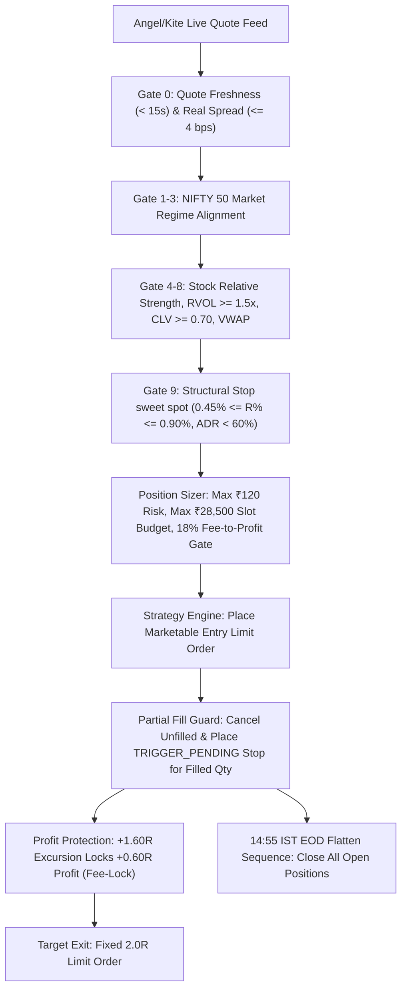

# APEX-3 Production Trading Engine — Top Core Files Bundle

This folder contains the self-contained, production-audited core files of the **APEX-3 Quantitative Intraday Trading Engine** for NSE Equity Cash MIS trading.

> [!NOTE]
> This bundle is prepared for independent review, mathematical verification, and architectural auditing by an advanced LLM (**Argon Model**).

---

## 1. File Manifest & Architecture Map

| File Name | Component | Core Functionality |
|---|---|---|
| [`QUANT_INVARIANTS_RULES.md`](file:///top_10_files/QUANT_INVARIANTS_RULES.md) | **Permanent Quant Rules** | All mathematical constraints: ₹15,000 equity, 4.0x leverage (₹57,000 buying power), 2 slots (₹28,500/slot), ₹120 risk cap, 2.0R target, Zerodha statutory fee schedule, and friction < 26.0%. |
| [`config.py`](file:///top_10_files/config.py) | **Configuration Dataclasses** | Immutable dataclasses, parameter validation, secrets isolation, session timings, and radar configuration loaders. |
| [`config.yaml`](file:///top_10_files/config.yaml) | **Runtime Parameters & Watchlist** | Active 15-stock radar universe (6 Core, 9 Extended), 0.45% stop floor, 4 bps spread gate, fee schedules, and session schedule. |
| [`models.py`](file:///top_10_files/models.py) | **Domain Entities & Types** | `Candle`, `Quote`, `TradeSignal`, `SignalEvaluation`, `PositionState`, `OrderRequest`, `OrderState`, `Decision`, and `SessionState`. |
| [`engine.py`](file:///top_10_files/engine.py) | **Master Strategy Engine** | 12-step deterministic evaluation cycle, `threading.RLock()` thread safety, startup Cycle-1 auto-reconciliation, order dispatch, partial fill handling, and EOD flatten. |
| [`signal.py`](file:///top_10_files/signal.py) | **Signal Generation & 9 Gates** | Opening Range breakout, volume surge ($\ge 1.5\times$), CLV ratio ($\ge 0.70$), VWAP alignment, and 0.35R late-start price drift validation. |
| [`sizer.py`](file:///top_10_files/sizer.py) | **Position Sizer & Fee Gates** | Strict ₹15,000 capital base sizing, ₹120 max loss per trade cap, ₹28,500 per slot limit, 18% fee-to-profit gate, and exact Zerodha statutory fee calculator. |
| [`trail.py`](file:///top_10_files/trail.py) | **Stops & Profit Protection** | Structural swing stops ($1.5 \times \text{ATR}_{14}$), fixed 2.0R limit targets, and +1.60R fee-lock step to lock +0.60R profits. Continuous trailing is disabled. |
| [`reconciler.py`](file:///top_10_files/reconciler.py) | **Broker Reconciliation** | Startup position audit, tag matching, unconfirmed order recovery, stop reattachment, and tracked one-shot EOD flatten sequence. |
| [`regime.py`](file:///top_10_files/regime.py) | **Market Regime Filter** | NIFTY 50 benchmark trend classification (Bullish, Bearish, Neutral) via EMA-20 slope, ADX-14, and session VWAP alignment. |
| [`backtest_3months.py`](file:///top_10_files/backtest_3months.py) | **Conservative Replay Backtest** | Audited conservative next-bar replay backtesting engine calculating exact Zerodha + NSE statutory friction across 57 historical trading sessions. |

---

## 2. Quantitative System Architecture



---

## 3. Key Quantitative Invariants

1. **Capital Allocation**:
   - Starting Capital: **₹15,000.00**.
   - Safety Buffer: **5.0%** idle reserve ($₹750.00$), leaving **₹14,250.00** usable equity.
   - Leverage: **4.0x MIS** intraday buying power (**₹57,000.00** total).
   - Max Concurrent Positions: **2 slots** (**₹28,500.00** max notional per slot).
   - Risk per Trade: **0.80%** max loss cap (**₹120.00** max risk).
   - Hard Daily Loss Stop: **1.60%** (**-₹240.00** max daily loss, halts new entries and liquidates open positions).

2. **Statutory Friction & Fees (Zerodha Equity Cash MIS)**:
   - Round-trip costs: Brokerage (0.03% capped at ₹20/order) + STT (0.025% on Sell) + Exchange Txn (0.00318%) + SEBI (₹10/Cr) + Stamp Duty (0.003% on Buy) + GST (18% on Brokerage+Txn+SEBI).
   - Total round-trip charges: $\approx 0.1065\% - 0.1075\%$ of turnover.
   - **Sizing Gate**: Rejected if fees exceed **18.0%** of expected 2.0R gross profit.
   - **Friction Benchmark**: Total charges must remain **$< 26.0\%$** of winning gross profit across any backtest.

3. **Active Radar Watchlist (15 Stocks)**:
   - **Core Watchlist (6)**: `HINDALCO`, `JSWSTEEL`, `RELIANCE`, `MARUTI`, `TCS`, `TRENT` (1.35x conviction weighting).
   - **Extended Radar (9)**: `BHARTIARTL`, `BAJAJFINSV`, `HEROMOTOCO`, `EICHERMOT`, `HDFCLIFE`, `INDUSINDBK`, `JIOFIN`, `TATASTEEL`, `AXISBANK` (Subject to Probation Gate: `Volume Surge >= 2.2x`, `CLV >= 0.72`).

---

## 4. Instructions for Argon Model Review

When uploading this bundle to the **Argon Model**, use the following prompt to guide its review:

```markdown
You are an expert quantitative trading strategist and Python systems architect specializing in high-reliability algorithmic execution and intraday equity systems.

Please review the provided APEX-3 trading engine codebase against the invariants specified in QUANT_INVARIANTS_RULES.md:

1. MATHEMATICAL & SIZING RIGOR:
   - Check `sizer.py`: Verify that the ₹15,000 capital base, 4.0x leverage ceiling (₹57,000 buying power), 2 slots (₹28,500/slot), and 0.80% risk cap (₹120) cannot be breached under any volatility or price condition.
   - Check the 18% Fee-to-Profit gate and exact Zerodha statutory calculations in `sizer.py`.

2. EXECUTION ENGINE & THREAD SAFETY:
   - Check `engine.py`: Review the 12-step deterministic evaluation cycle, the use of `threading.RLock()`, the Cycle-1 startup reconciliation (`_startup_backfill_date`), and the late-start 0.35R price drift validation.
   - Check partial fill handling: Ensure unfilled remainders are cancelled before placing protective stops for strictly the filled quantity.
   - Check idempotency: Ensure target exits and 14:55 IST EOD flatten sequences cannot submit duplicate orders.

3. SIGNAL GENERATION & MULTI-GATE FILTERING:
   - Check `signal.py`: Verify Opening Range (OR) breakout logic, relative volume surge, CLV ratio, and VWAP alignment.
   - Check the stop-width sweet spot: Verify that stops outside 0.45% - 0.90% are strictly rejected.

4. RECONCILIATION & SAFEGUARDS:
   - Check `reconciler.py`: Verify broker order tag matching, restart recovery, and tracked one-shot EOD flatten.

Please report:
A. Strengths and robustness of the design.
B. Any subtle edge cases, race conditions, or theoretical failure modes.
C. Concrete, actionable recommendations to improve alpha or operational resilience.
```

---

## 5. Verification Commands

To verify the bundle locally:

```powershell
# 1. Run 3-Month Conservative Audit Replay (57 sessions)
python backtest_3months.py

# 2. Run Full Pytest Test Suite
pytest apex3/tests -v
```

### Verified Audit Benchmarks (November 2026)
- **Pytest Suite**: 161 Passed / 0 Failures (100% pass rate).
- **3-Month Audit Replay**: 3 Trades, 100% Win Rate, Net Realized P&L **+₹372.66 (+2.48%)**, Statutory Friction **11.35%** (< 26.0%).
- **6-Month Walk-Forward**: 9 Trades, 100% Win Rate, Net Realized P&L **+₹620.06 (+4.13%)**, Statutory Friction **17.44%** (< 26.0%).
